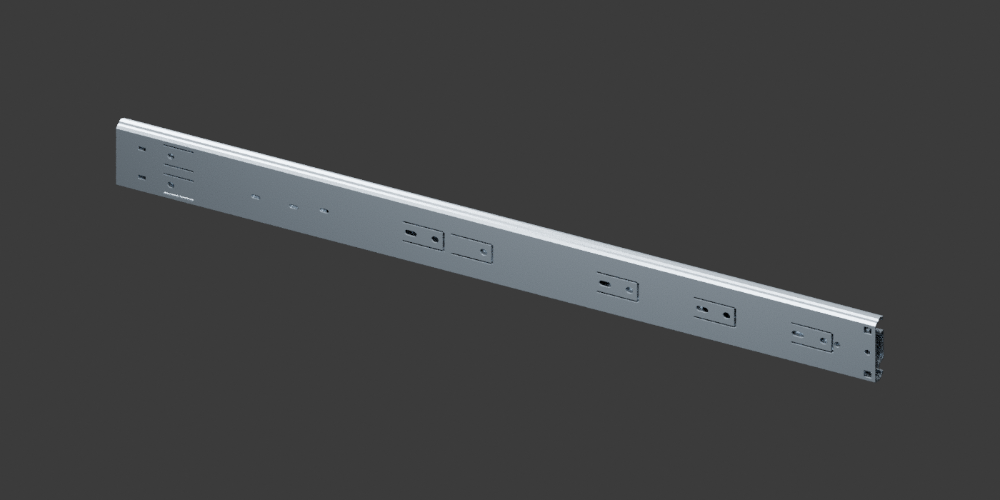

# 东泰 DTC 抽屉滑轨 · 50 cm 款

用户确认此既有文件对应东泰 DTC 抽屉滑轨 50 cm 款。本次仅归档原 STEP 并派生预览，**没有重新建模、修改几何或重新导出 STEP**。

- [原始 STEP：slide_photo_estimate_closed.step](slide_photo_estimate_closed.step)
- [模型预览](DTC_500mm_预览.png)
- [导入检查记录](source_check.json)

## 范围与精度

这是既有照片估算模型，不是厂家认证 CAD。端部与安装孔位没有实测确认，不可直接用作开孔、加工或互换性判定。50 cm 为用户确认的款式长度，不据此推断具体商品型号。

导入检查：65 个实体，几何有效；模型外包络约 500 × 12.7 × 45.7 mm。这是文件中几何的读数，不是新增实物测量。原文件表示闭合状态，本次未增加伸缩动画。

预览通过原 STEP 曲面离散化后渲染生成，未更改原文件。与同分类中的 `DTC45871H_400mm_运动包络参考` 独立存放，不覆盖、不混用 40 cm 参考版。

## 原文件校验

- 大小：3,085,108 字节
- SHA-256：`f039807390f91c019d3c3a5c697038b6921e3819fdc3bc3d1e60d15341f9f311`
