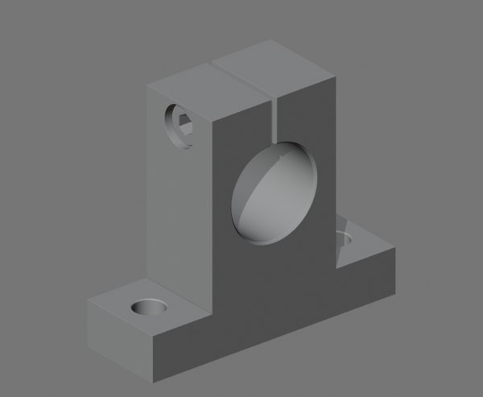

# Ø20 立式开口光轴固定座

用户提供的商品尺寸图标注为单批次测量值；具体品牌、型号和公差未确认。此模型为装配占位参考，不是加工图。

| 项目 | 图示尺寸 |
| --- | ---: |
| 光轴孔 | Ø20 mm |
| 总宽 × 轴向厚度 × 总高 | 58.8 × 19.6 × 50.8 mm |
| 底面至轴心 | 30.8 mm |
| 底座厚度 / 上部宽度 | 10 / 30 mm |
| 底座两通孔 | 2 × Ø6.6 mm，中心距 44.7 mm |
| 横向夹紧螺钉 | M5 × 25 |

Blender 5.0，1 单位为 1 mm。X 沿光轴，底座朝 −Z；夹座和 M5 螺钉是独立实体。未标注的开口宽度、螺钉头、内六角和倒角为参考造型，螺纹未逐牙建模。已检查两零件为闭合网格；配合同轴度、夹紧力和防滑移需要实物核对。

复建：`blender -b -P build_model.py -- /绝对/输出目录`
