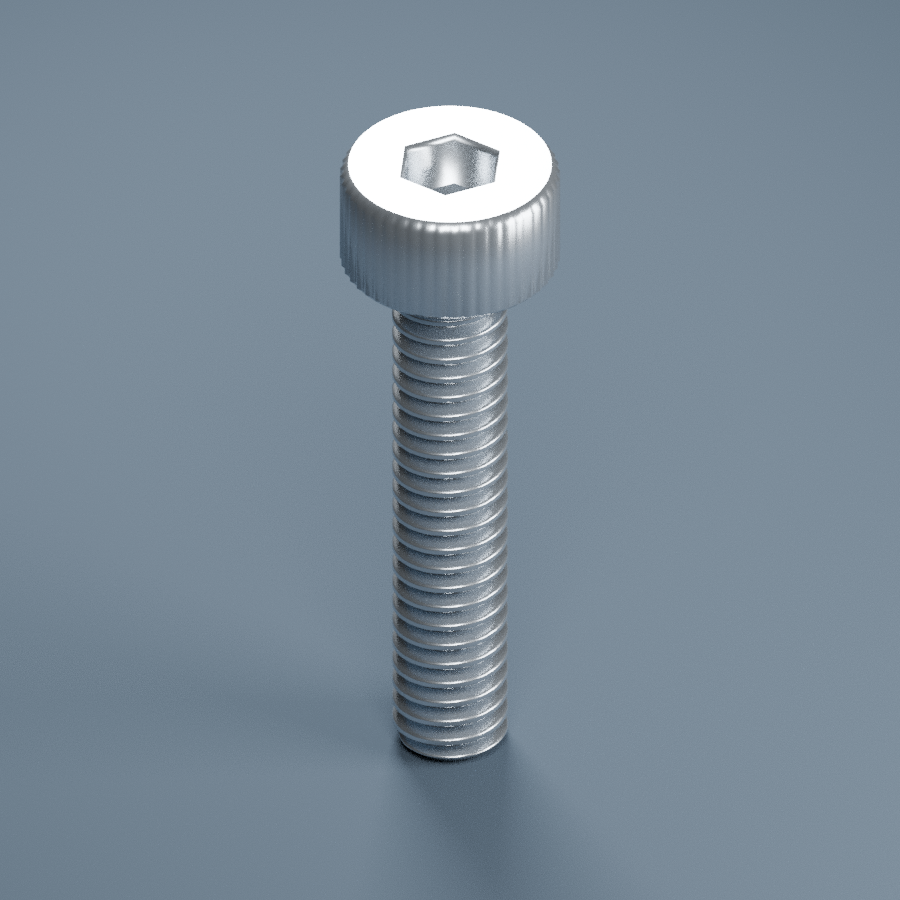

# 内六角圆柱头螺丝 M2×10

独立可编辑 Blender 模型。头下长 10 mm，参考头高 2 mm，总长 12 mm。

[共用实物照片](../M2x7与M2x10_共用实物图.jpg)

尺寸来源及假设见模型说明.txt。只有标签M2×10来自实物图，其他尺寸须实测确认。

## 补充实物参考（2026-11-13）

[四格补充照片](../../参考照片/20261113_M2x7_M2x10与中部直纹销轴_补充实物图.jpg)

已与本条目的标签规格和可见头型/中部直纹结构核对；未发现可辨别的新规格，不重复建模。原图保留。补充照片不改变原有未实测尺寸、公差与材质限制。
