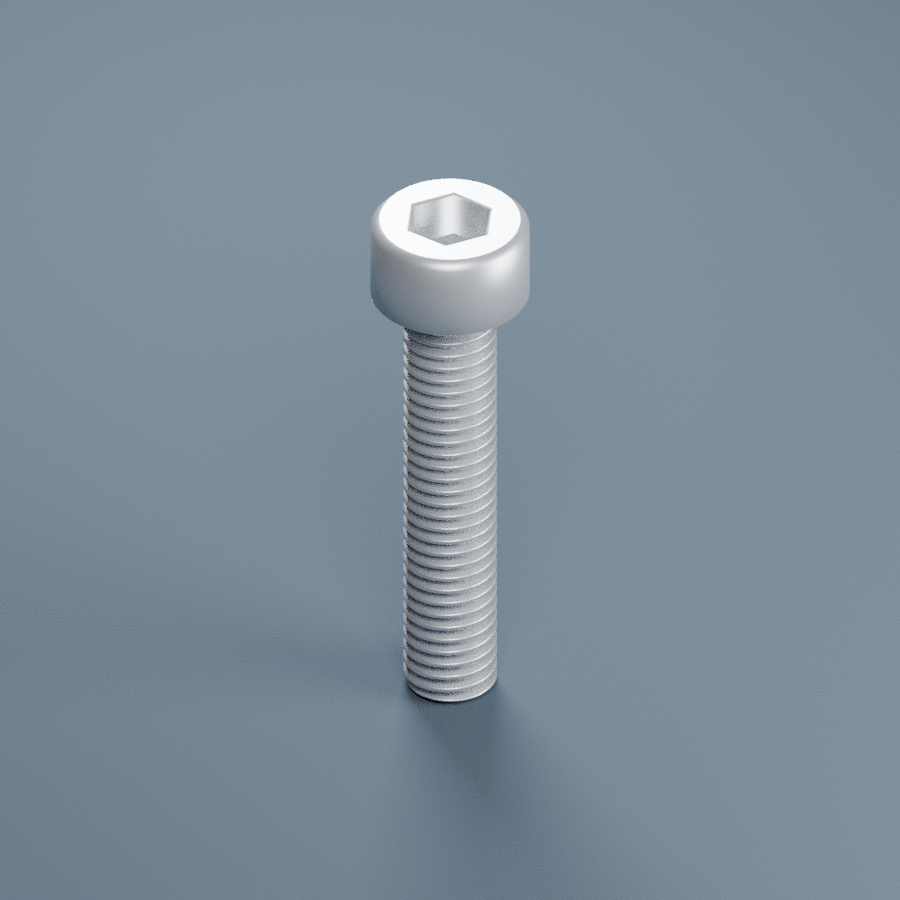

# 内六角圆柱头螺丝M5x25

[可编辑Blender](内六角圆柱头螺丝M5x25.blend) · [参数脚本](build_model.py)

内六角圆柱头螺丝M5x25 · 参数化名义装配模型

来源：用户订单规格 M5×25，标题304；并非实物测量。

名义参数：头下长度25mm，头径8.5mm，头高5mm，六角对边4mm，槽深采用表列最小值2.5mm。右旋粗牙M5×0.8，全牙版本。

参考尺寸来源：Bossard BN3 DIN912/ISO4762全牙产品尺寸表，https://media.distrelec.com/Web/Downloads/_t/ds/1003763_eng_tds.pdf ，检索2026-11-13。仅借用标准形状尺寸，不声称用户零件为Bossard品牌、8.8级或镀锌。订单304仅作为采购文字记录，非材质认证。

模型使用全牙版本。长规格也可能实际为半牙；当前无实物证据，需核对牙长。牙型/截顶/根部圆弧/退刀/倒角/槽口和表面纹理简化，无制造公差；槽口倒角属于展示假设。

用途：库存识别、名义装配包络，非生产图纸或强度认证；不能用于直接加工螺纹。单位mm，原点尖端，+Z朝头。

螺距来源：https://www.accu.co.uk/api/product-datasheet?id=652689（相同公称直径的粗牙产品资料）。

用户2026-11-13确认允许杯头暂按全牙建模；这不是实物全牙测量认证。
