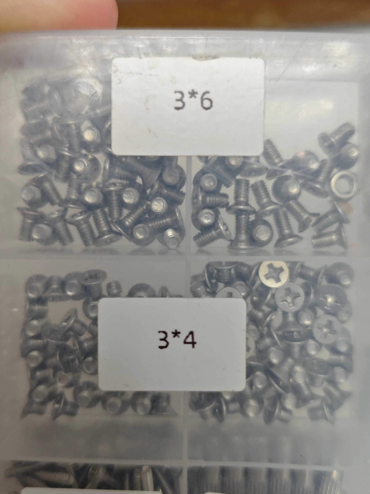

# 十字沉头螺丝M3x4

[可编辑 Blender 模型](十字沉头螺丝M3x4.blend) · [尺寸假定与来源](模型说明.txt) · [重建脚本](build_model.py)

照片标注 **3×4**，按 M3、含头总长 4 mm 建模。螺距按常用 0.5 mm，头部、槽深等未实测值见说明，材质与强度等级未确认。

## 共用实物照片

两种规格分别建模，以下照片仅保存于父目录一份。

