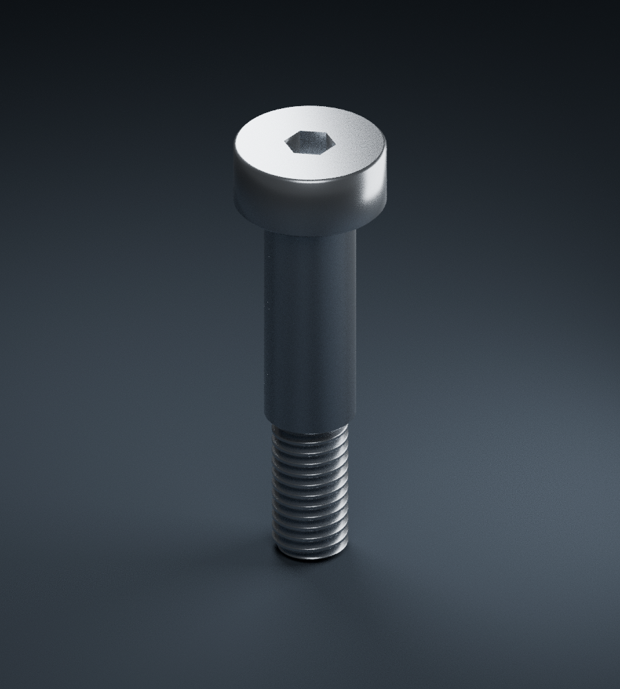

# 304塞打螺丝6x16xM5

304塞打螺丝6x16xM5｜商品尺寸图参考模型，非加工图
来源：用户2026-11-13提供的佰瑞特商品尺寸图。
图上明确标注（mm）：光杆直径6、光杆长度16，螺纹M5、长10、螺距0.8，头径10、头高4.35，内六角对边3。名义总长30.35。
光杆长度不含头和螺纹；头下平面z=0，肩至z=-16，端至z=-26。1 Blender单位=1mm。
六角槽深暂取2mm，倒角、退刀槽和牙底细部均为参考。真实螺旋方向与名义螺距，非制造认证的完整牙型。
图注称单批次测量且以实购为准；上述尺寸并非用户卡尺实测。304依据商品说明，不是材料检测。图示包装数量不计为实际库存数量。
本项为新规格，不覆盖4xM3x3或其他旧肩长。不可依据本模型进行极限配合、强度认证或直接加工。

[模型](304塞打螺丝6x16xM5.blend)