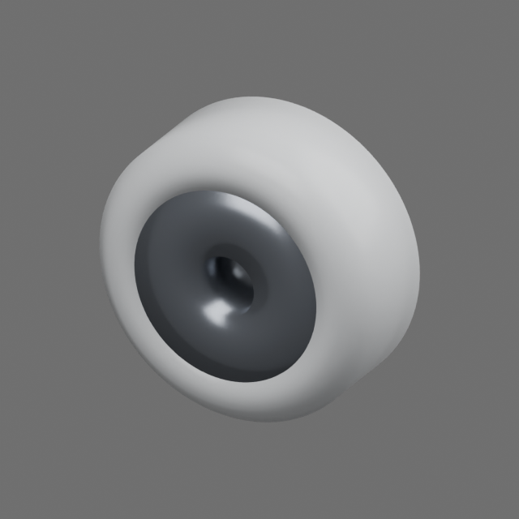

# 大平轮_D24p1_W11_孔5

- [可编辑 Blender 模型](大平轮_D24p1_W11_孔5.blend)
- [参数与假定](参数.json)
- [分类生成脚本](../build_wheels.py)

## 已知外形（毫米）

外径 24.1 mm，轴向总宽 11 mm，孔径 5 mm。

## 模型边界

侧倒角1.8mm为外观占位，非图中标注；内部轴承/钢芯直径未知。轮体材料、硬度、承载能力及尺寸公差未确认。钢芯仅占位，不是已识别型号的轴承内部。适合布局和装配包络，不能用于加工或直接认定配合。

截面网格和旋转修改器可编辑；尺寸自定义属性只是规格记录，并未自动驱动几何。场景单位 0.001，轮轴沿 Y。Blender 5.0.1 保存。

## 使用

打开 blend 后，装配仅使用该轮的集合，不需要相机和灯光。生成脚本在分类目录运行，输出到 `generated`，不会覆盖本归档。三款均沿用已交付模型，未改动夹爪。
