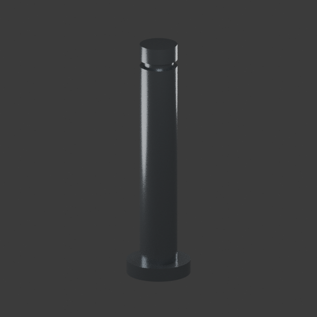

# D5 × 30 带槽销轴，标注有效 27 mm

- [可编辑 Blender](销轴_D5x30_有效27.blend)
- [尺寸说明与边界](模型说明.txt)
- [生成脚本](build_model.py)
- [数字检查](数字模型检查.json)

D5 带头带槽销轴：杆长30 mm，商品图标注有效长度27 mm。
来源：用户2026-11-16提供的商品尺寸图。不是已购买/库存持有确认。
标注：杆直径5；杆总长30（不含头）；头直径8.5；头厚1.8；槽宽0.9；槽径4；配套E卡标识M4。
模型轴为Z，头下平面z=0，头z=-1.8..0，杆z=0..30。
模型把27解释为头下至近头槽边，槽z=27..27.9；图的箭头与实际挡圈承压面定义仍应核实。27不是整根销总长；含头总包络31.8。
槽边/头部圆角、倒角、表面处理、材料、强度、尺寸公差均未标，不据照片比例补作精确事实；模型为名义直角包络。
E卡只记录M4商品标识，本模型不包含未经实测的精确E卡。实际装配应测E卡厚度、槽位、夹持跨度和防脱配合，不能仅凭27mm标签判断无游隙。
这是可编辑名义参考模型，不是制造图或承载认证；无证明已购入。旧D5×25目录保留，不替换。
生成脚本可在Blender运行，重建同目录.blend与预览。场景单位0.001，显示毫米，预览相机灯光单独集合。
