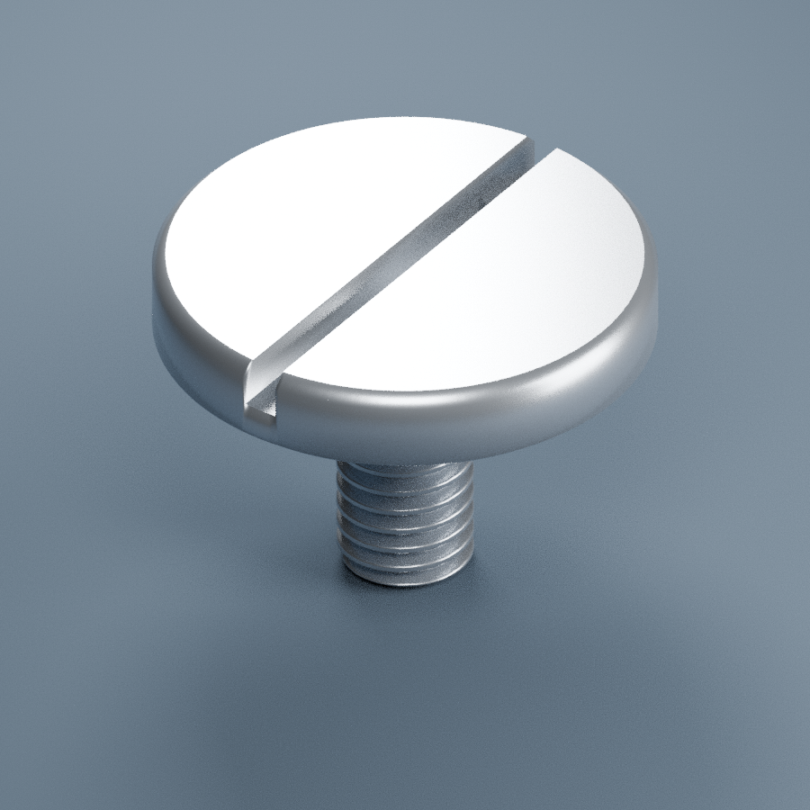

# 304_GB833_M3x6

GB833 M3×6 开槽大圆柱头螺钉，304商品图参考。
用户2026-11-13提供科瓦格五金商品图：M3螺纹长6mm（不含头）、头径11mm、头高2mm、槽宽0.8mm，总轴向8mm。商品图声明为单批次数据，以实物为准。
M3×0.5采用常用粗牙名义值；槽深1mm为参考假定，原图未标，不应声称已实测或已验证完整GB833合规。倒角、螺纹牙底和退刀细节近似。标准名称核对 https://openstd.samr.gov.cn/bzgk/std/newGbInfo?hcno=31019DA6344DE3F167C586FC88DA2ECB 。
1单位=1mm，原点螺纹端，+Z朝头部。无加工公差、材质检测或强度认证。只用于库存识别/装配参考。商品包装5个不自动认定实际库存数量。

[模型](304_GB833_M3x6.blend)