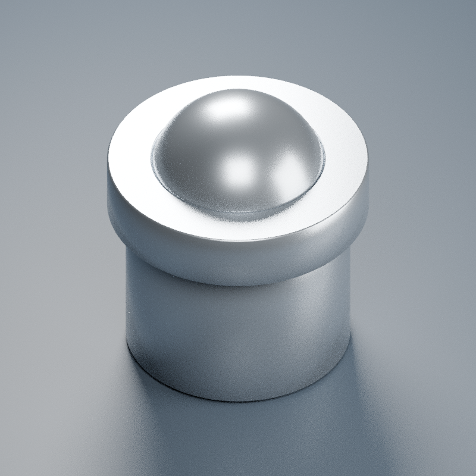

# D3x3_有台阶_10N

尺寸来自商品图：壳体Ø3×长3mm（含台阶），法兰Ø3.5×厚0.8，钢珠Ø2.38，露出0.85±0.15mm。图称标准弹力10N，仅厂商标称，模型不验证。原点壳体底面，+Z出珠方向，1单位=1mm。壳体、球、内部弹簧分离；球处于名义伸出位置。内部孔/封底/弹簧直径圈数为视觉假设，不代表真实行程、弹簧刚度或制造配合，尚无压缩动画以免暗示未知可用行程。不得依据此模型加工定位珠。

[模型](D3x3_有台阶_10N.blend)