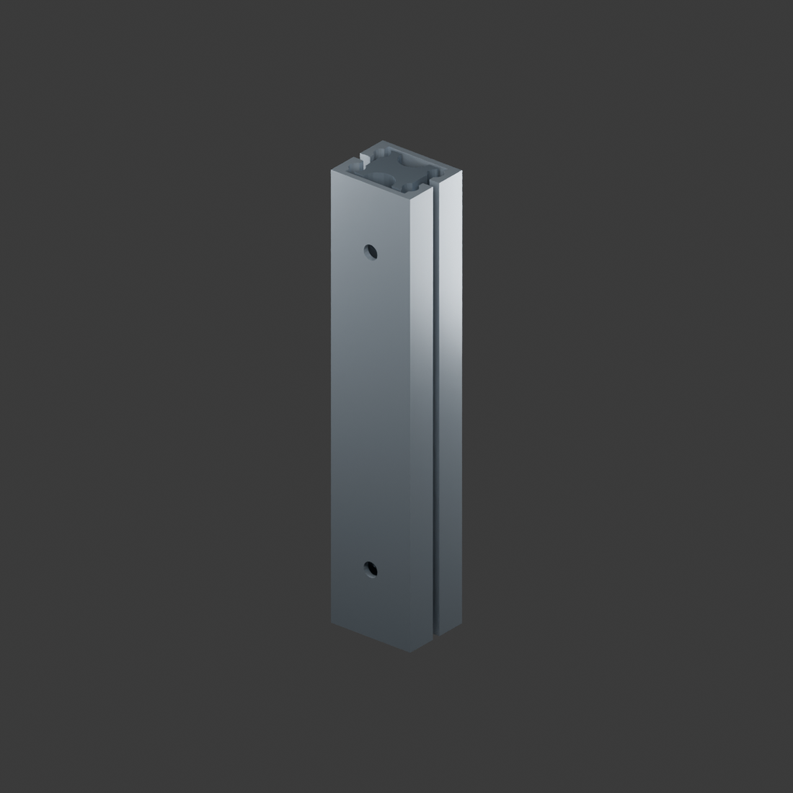

# 双层 20 mm 宽 · 100 mm 微型铝合金滑轨

本版本由用户提供的 **slider.f3d** 提取，不是对 70 mm 版本拉伸。70 mm STEP 版本独立保留。

- 原始 `slider.f3d` 字节原样保存；其中的 Fusion 特征数据与装配连接仍留在原文件。
- Blender 5.0.1 工程为 3 个独立闭合网格，从原文件内置 OGS 显示网格读取。包络为 **20 × 16 × 100 mm**。
- 原始记录中发现 `DcExtrudeFeatureMetaType`、`DcJointAsBuiltFeatureMetaType`；**未完整解码特征依赖、关节类型与限位**，不宣称已将 Fusion 参数历史或原生约束迁移进 Blender。
- 网格是显示缓存精度，不是精确 BREP。原始曲面与特征请继续在 Fusion 中编辑。

## 新建的示意运动

Blender 内新建 `Motion_Control_RECONSTRUCTED_DEMO` 控制对象，两个属性分别控制中轨轴向位移及上轨相对中轨的轴向位移。三个部件只沿原长度方向 Z 移动；没有重建原始 Fusion 关节求解器。

第 1–195 帧：闭合 → 每级移动 20 mm → 停留 → 收回，30 fps。**20 mm 只是可见演示量，不是实际额定行程，也不是源文件的关节限位。** 没有做承载、摩擦、止挡或干涉认证。

## 验证与复现

三个提取部件均闭合、无非流形边，外轨截面 20 × 7 mm，中轨截面约 11.8 × 11.6 mm；长度均为 100 mm。保持源缓存共同坐标系。`build.py` 使用同目录 `mesh.json` 重新生成工程与预览。

OGS 二进制字段解码参照 [ezf3d 格式文档](https://github.com/AlexSabaka/ezf3d/blob/main/docs/format/graphics-cache.md)，使用本任务独立编写的提取程序读取缓存。未安装或运行第三方 GitHub 软件。
