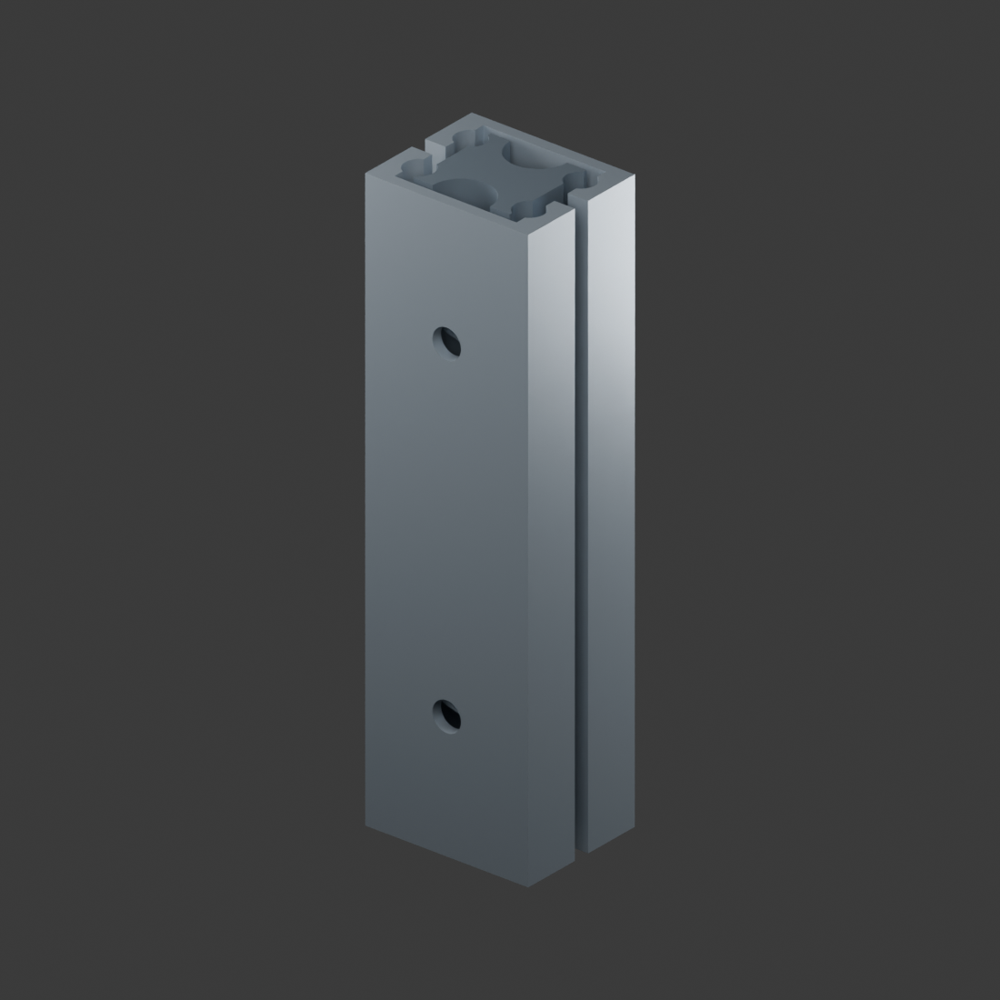

# 双层款超窄 20 mm 宽微型铝合金滑轨

用户提供的原 STEP 转换为 Blender 5.0.1 工程，不重新推测或重建尺寸。

- `双层20mm微型铝合金滑轨.blend`：3 个独立可编辑网格，保留装配相对位置，仅将公共中心平移至原点。
- 原 STEP 完整保留，适合继续 CAD 编辑；Blender 转换没有恢复参数化特征树。
- 文件内整体包络为 **20 × 16 × 70 mm**，不是新增实物测量。
- 三个网格均为闭合流形；原 CAD 实体有效。曲面离散容差 0.025 mm，体积相对误差小于 0.04%。
- 未推断型号、承重、公差、有效行程或止挡，也未增加伸缩动画。不是厂家认证的采购尺寸图。

## 复现

使用 CadQuery 2.7.0 运行 `extract.py` 从本目录原 STEP 提取 `mesh.json`；再用 Blender 5.0.1 的后台 Python 运行 `build.py` 生成工程与预览。几何使用毫米，场景单位比例 0.001。

原 STEP SHA-256：`61d6a59e635ae6107e30a73102324112bef4c7a0d192a3346ee6ddbe63c31d73`。
