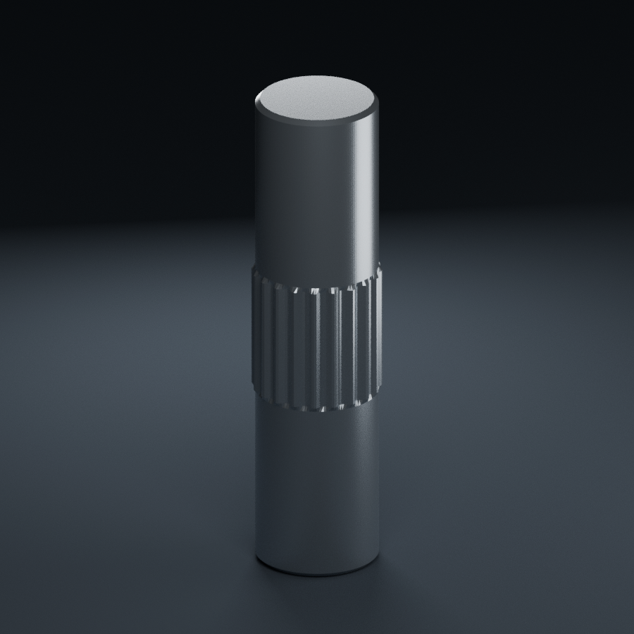

# 中部直纹销轴 Ø2 × 8 mm

依据共用实物照片，标签的 m 解释为销轴直径而非螺纹。
模型含独立闭合实体；build_model.py 可重建，详细假定见模型说明.txt。

中部直纹仅为参考轮廓，不是经过认证的精密花键标准。头两项标称尺寸之外，纹长、齿顶外径、齿数、倒角等均待实测。不可直接据此确定过盈量。

本次使用 Blender 4.3.2，未在 5.x 实际打开验证。

[可编辑 Blender 模型](中部直纹销轴2x8.blend) · [尺寸说明](模型说明.txt) · [共用实物照片](../中部直纹销轴_共用实物图.jpg)

## 补充实物参考（2026-11-13）

[四格补充照片](../../参考照片/20261113_M2x7_M2x10与中部直纹销轴_补充实物图.jpg)

已与本条目的标签规格和可见头型/中部直纹结构核对；未发现可辨别的新规格，不重复建模。原图保留。补充照片不改变原有未实测尺寸、公差与材质限制。
