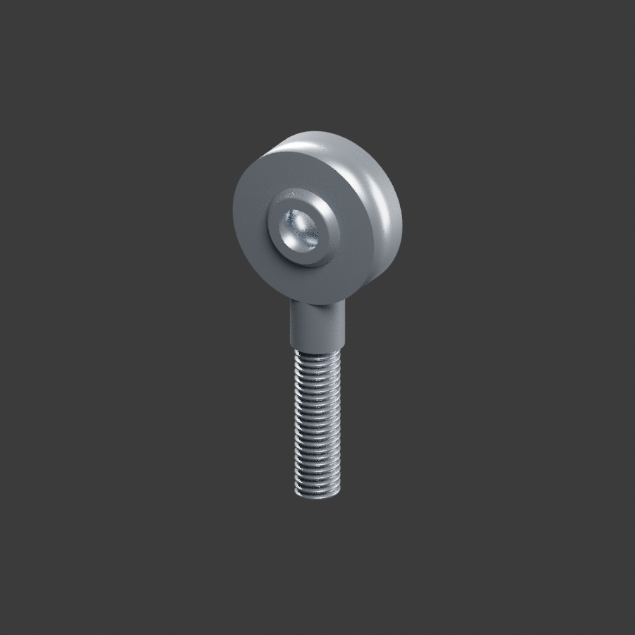

# SA5T_K

SA5T_K 免维护杆端关节轴承，厂家图纸参考装配模型。

名义尺寸孔5、球面直径11.11、内圈宽8、壳体宽6、头外径18、M5×0.8右旋。中心至端部33、总长42mm。外螺纹段长19mm。

来源 https://www.dfnbearing.com/products/Rod_End_Bearings_1322318/Rod_End_Bearings.html （2026-11-13核对表及系列示意图）。

孔沿Y，杆轴Z，底端Z0，球心Z33；球面内圈独立可动。外壳颈部过渡、倒角、球面显示间隙0.025mm、衬层及牙型截顶简化；厂商不同颈部曲线可能不同。未作制造公差或承载验证，不等于用户实物品牌确认。

可修改 build_model.py 重建。单位 mm，Blender 4.3.2 创建。
