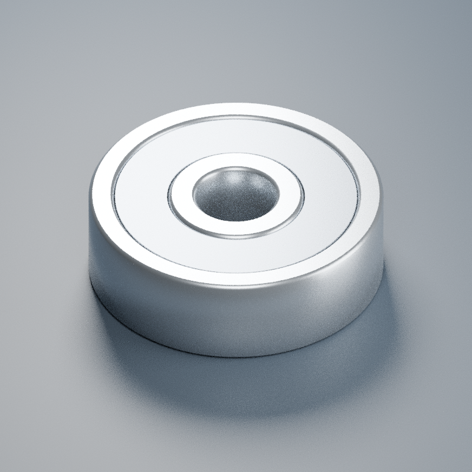

# 636ZZ轴承

636ZZ轴承
名义装配尺寸：内径 6 mm × 外径 22 mm × 宽 7 mm。
来源：https://www.nsk.com/engineering/636zz-esm-md.html
ZZ双面金属防尘盖外观装配模型；公称包络据NSK系列尺寸参考，不认定实购物品品牌、游隙或内部规格。
轴向 +Z，原点下端面中心。1 Blender 单位=1mm。
倒角、内外圈分界直径、防尘盖压纹/厚度均为示意，不是厂家制造尺寸；未建滚珠、保持架和真实滚道。不声明精度等级、游隙、载荷性能或具体品牌。不得用于加工、载荷计算或印证内部碰撞。
模型目的：库存识别、名义孔径/外径/宽度的装配布置。实际配合公差及轴肩圆角需按所购型号和图纸核对。
build_model.py 可独立重建，同目录文件会覆盖，请先备份。

[Blender模型](636ZZ轴承.blend)
