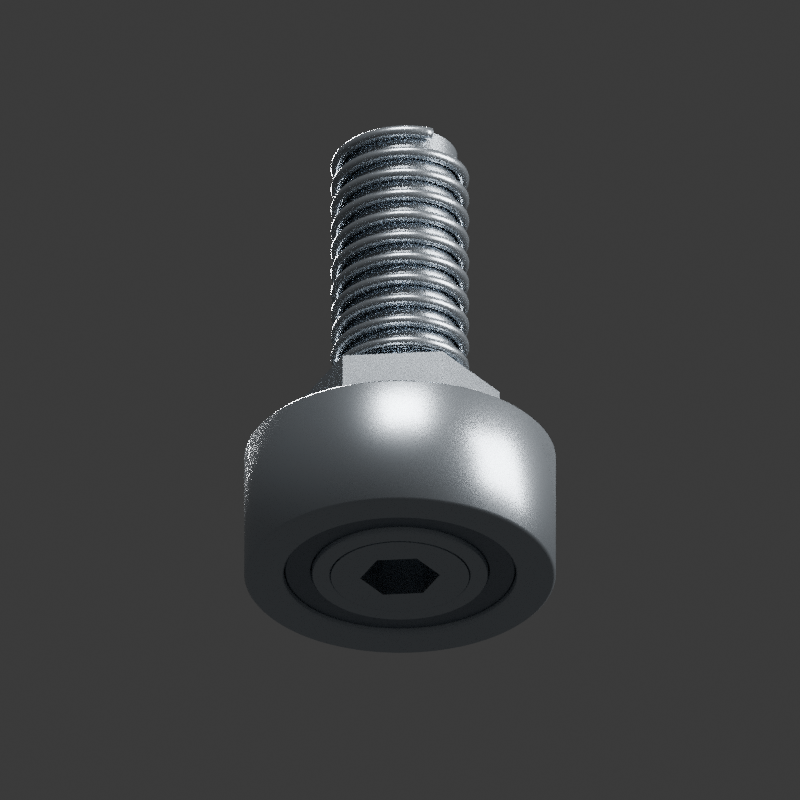

# NST-JS6849-4C2L8M4

用户2026-11-18商品图：NST-JS6849-4C2L8M4，D9、W4、C2、M4牙长L8，合计14mm；1单位=1mm。原点轴承前端面，+Z指向螺纹。轴承外圈独立对象。照片/剖面显示台阶外六角及前端内六角，但未标对边和槽深：模型台阶AF5（对角5.774）、驱动槽AF2深1.5、芯轴D4、内部环界面、倒角、金属盖外观全部为示意假设。M4螺距暂按常用0.7，牙型简化。胶盖或铁盖需以实购物为准；没有仿真滚珠/滚道/内部承载。不可将未标尺寸当实测，不可据本模型确认载荷、夹紧、防脱或采购盖型。

[模型](NST-JS6849-4C2L8M4.blend)